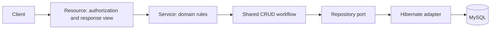
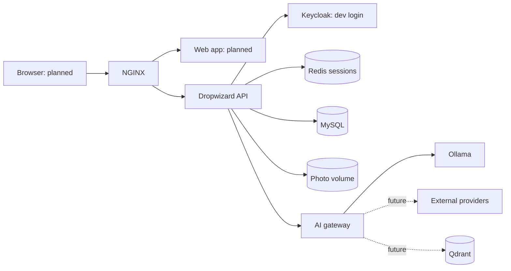
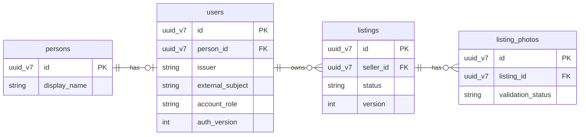
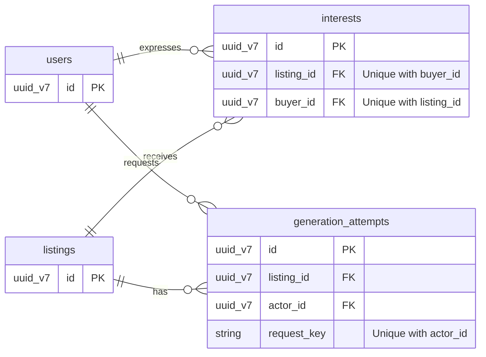

<h1 align="center">LoopMarket</h1>

<p align="center">
  <strong>A marketplace for second chances, built with an agentic mindset.</strong>
</p>

<p align="center">
  
  
  
  
</p>

LoopMarket is a second-hand marketplace where sellers create listings, optionally request AI suggestions, and approve publication. Buyers can browse published listings and express interest; interest is a stored signal, not a messaging or payment system.

**Status:** The backend and development authentication are implemented and tested. The web and Flutter applications, external AI providers and production deployment are planned.

## Run locally

Requires Docker and Docker Compose 2.20 or later. From the repository root:

```sh
./.docker/server.sh dev start backend       # Starts the API, MySQL, Redis and Keycloak
./.docker/server.sh dev list                # Available services
./.docker/server.sh dev status              # State and memory usage
./.docker/server.sh dev logs backend redis  # Follow selected logs
./.docker/server.sh dev stop backend        # Stop without deleting data
```

The first run creates `.env-dev` from `.env-dev.example` and may download images and build dependencies. `dev` is configured; `qat`, `uat` and `prd` are reserved. With default ports, open [Swagger UI](http://localhost:8080/api/docs/) or the [hello endpoint](http://localhost:8080/api/hello).

Development accounts are seeded for local use only:

| Username | Password | Role |
|---|---|---|
| `darth.vader` | `dark-side-1977` | Admin |
| `luke.skywalker` | `force-1977` | User |

Use **POST /sessions** in Swagger to obtain an `accessToken`, then select **Authorize** and enter the token. The backend issues opaque, 30-minute sessions, checks Redis and the local account on each protected request, and revokes a session on logout. Keycloak verifies the development credentials. These credentials and the development login flow are not a production identity setup.

`photoMaxBytes` in `backend/config.yml` controls the decoded image limit: **20 MiB by default**, configurable from 1 byte to 64 MiB. The development NGINX reads the same setting and accounts for base64 overhead. After a change, run `./.docker/server.sh dev start backend nginx`.

## API and design decisions

- **Clear boundaries:** `/api/catalog` exposes published listings and photos; `/api/users/me/listings` and the CRUD endpoints are scoped to the authenticated owner. Seller views include interest counts and buyer display names without exposing contact information.
- **Safe writes:** draft creation and publication use an `Idempotency-Key`; listing edits and state changes use an expected version. MySQL constraints and transactional locks protect duplicate interests and the archive/interest race.
- **Review before publication:** deterministic suggestions are labelled as demo output. Local inference uses the configured gateway and never edits or publishes a listing. The seller reviews every suggestion; malformed output and uncertain provider outcomes leave manual editing available.
- **Auditable data:** application tables use UUIDv7 IDs and UTC creation, update and soft-deletion timestamps. Liquibase manages schema changes; Redis stores temporary sessions rather than marketplace data.
- **Predictable errors:** API errors use `application/problem+json`; validation responses can include field-level details. The frontend can use the attempt status and `GENERATION_OUTCOME_UNKNOWN` to handle an interrupted model call.

Swagger documents the request schemas and examples. See the [frontend integration guide](docs/frontend-api.md) for the complete API flow and [database model](docs/database-model.md) for fields and constraints.

## Generic CRUD strategy

The `backend/shared` module centralizes CRUD behavior shared by multiple resources while keeping entity-specific rules in their own services and resources:

| Layer | Responsibility |
|---|---|
| `GenericEntity` | UUIDv7 identity, UTC audit timestamps and soft deletion. |
| `GenericRepository` and Hibernate adapter | Persistence operations, active-record filtering and caller-specific scopes. |
| `GenericCrudService` | Common create, read, list, update and soft-delete workflows; concrete services map inputs and enforce domain rules. |
| `GenericCrudResource` | HTTP endpoints, pagination, request validation and response mapping; concrete resources determine authorization and safe views. |

This removes repeated endpoint and persistence plumbing while keeping rules visible: for example, listing publication checks ownership, version and validated photo; interest creation checks listing visibility and buyer identity. Those operations have explicit domain methods and database boundaries rather than being reduced to generic CRUD.



## Services and structure

Each service has a Dockerfile and Compose definition, and containers share the `zartis` network. Backend Maven modules are shown separately to make their responsibilities clear.

```text
LoopMarket
├── backend
│   ├── app                    (Dropwizard API, marketplace workflows and migrations)
│   ├── shared                 (generic CRUD, persistence port and common entity)
│   ├── platform/identity      (identity and Redis session components)
│   └── product/marketplace    (initial marketplace domain and greeting)
├── frontend                   (Next.js, React and TypeScript; planned)
├── mobile                     (Flutter and Dart; planned)
├── ai
│   ├── ai-gateway             (deterministic and Ollama routing)
│   └── ollama                 (local model runtime)
└── infrastructure
    ├── nginx                  (application ingress)
    ├── mysql / redis          (marketplace data / sessions)
    ├── keycloak               (development identity)
    ├── qdrant                 (vector database; retrieval not integrated)
    ├── elasticsearch / kibana / elastic-agent  (observability)
    └── sonarqube / postgresql (code quality and its database)
```



## AI configuration

Deterministic suggestions work without a model. For local inference, set `AI_GATEWAY_MODE=ollama` and `OLLAMA_MODEL=qwen2.5:0.5b` in `.env-dev`, then:

```sh
./.docker/server.sh dev start ollama ai-gateway
docker compose --project-directory "$PWD" --env-file .env-dev -f .docker/docker-compose.yaml \
  --profile apps --profile mobile exec ollama ollama pull qwen2.5:0.5b
```

The model download uses network bandwidth and disk space. Local inference has been exercised, but its quality evaluation remains pending; output may contain unsupported details. External provider adapters are future work. See [generation evaluation](docs/generation-evaluation.md).

## Verification

With the backend container running, run the Java suite and Compose/resource checks:

```sh
docker compose --project-directory "$PWD" --env-file .env-dev -f .docker/docker-compose.yaml \
  --profile apps --profile mobile exec backend mvn -B -ntp test
make check
```

The isolated two-user API journey has been exercised with MySQL, Redis and Keycloak, including publication, discovery, interest, concurrent requests, session revocation and failure recovery. Local Ollama inference and the 20 MiB photo boundary have also been exercised. Integration tests are opt-in and create records; their scope and results are described in [backend verification](docs/backend-api-plan.md).

Old image files and files left by a failed database transaction are retained; automatic orphan cleanup is not implemented.

## Data model

The MVP model uses UUIDv7 IDs and UTC creation, update, and soft-deletion timestamps on every table. The diagrams show relationship keys; see [the database model](docs/database-model.md) for all fields and rules. MySQL stores product data, while Redis holds temporary session state and is not a table in these diagrams.

### Accounts and listings



A listing may have at most one **active** photo; older soft-deleted records can remain.

### Buyer interest and AI


