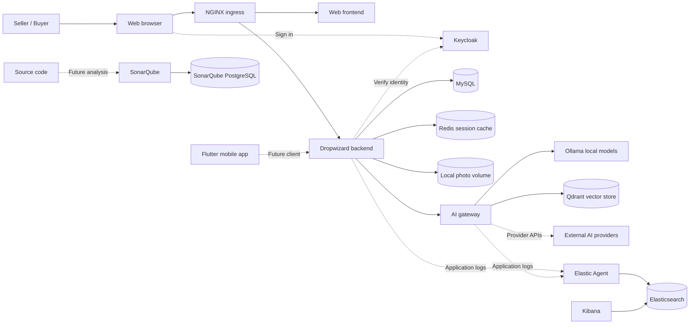

```text
    __                    __  ___           __        __
   / /   ____  ____  ____/  |/  /___ ______/ /_____  / /_
  / /   / __ \/ __ \/ __  /|_/ / __ `/ ___/ //_/ _ \/ __/
 / /___/ /_/ / /_/ / /_/ /  / / /_/ / /  / ,< /  __/ /_
/_____/\____/\____/ .___/_/  /_/\__,_/_/  /_/|_|\___/\__/
                 /_/        > EVERY ITEM HAS A NEXT CHAPTER <
```

<h1 align="center">LoopMarket</h1>

<p align="center">
  <strong>A marketplace for second chances, built with an agentic mindset.</strong>
</p>

<p align="center">
  
  
  
  
</p>

LoopMarket is a planned second-hand marketplace that helps people create useful listings and connect with potential buyers. Sellers provide a photo and item details, review optional AI-generated suggestions, and decide what to publish. Buyers discover published items and express interest; sellers see that interest in their dashboard.

This independent portfolio project explores the product and engineering responsibilities of an Agentic Product Engineer: taking a marketplace idea from requirements through full-stack delivery, working with coding agents, and reviewing their output. It is not a client assignment or an Adevinta product.

**Current status:** The repository contains development container configuration and application workspaces. The marketplace, AI gateway, mobile application and integrations are not implemented yet. The diagram below describes the intended architecture, not a running product.

## Quick start

From the repository root, with Docker and Docker Compose installed:

```sh
./.docker/server.sh list               # List available services
./.docker/server.sh status             # Show container state and memory usage
./.docker/server.sh start mysql redis  # Build and start selected services
./.docker/server.sh stop mysql redis   # Stop them without removing data
```

Replace the service names with `all` to start or stop every defined service. Starting services builds their images and may download base images. The application workspaces are currently placeholders, so starting the stack does not yet launch a working marketplace.

## The product

The planned journey is straightforward:

1. A seller signs in, creates a draft and adds a photo and confirmed item details.
2. The seller can request AI suggestions for the title, description and category, then edit, accept or ignore them.
3. The seller reviews and explicitly publishes the listing. AI never publishes on the seller's behalf.
4. A buyer searches the catalog, opens a listing and expresses interest.
5. The seller sees that interest alongside their listings.

A buyer's interest is a saved signal, not a payment, order or chat. The manual listing journey remains available when AI assistance is unavailable. A responsive web experience is the initial interface; a Flutter mobile application is planned for later.

## Technology and boundaries

The backend is planned as a modular Java application using Dropwizard and Maven. Next.js, React and TypeScript are proposed for the web frontend, while Flutter and Dart are the chosen mobile stack. Product rules, including authorization and publication, belong to the backend.

An AI gateway is planned to select between a local model runtime and external provider APIs. Ollama is configured as the local runtime and Qdrant as the AI vector store. Model selection, image support, provider integrations and gateway implementation remain open. NGINX is a separate ingress gateway for browser traffic.

The development infrastructure uses MySQL for product data, Redis for user session caching, Keycloak as a local identity candidate, SonarQube for code quality and the Elastic stack for logs and observability. Session ownership, expiration and the integration with the identity provider remain to be designed. These are configured development services; their integration with the product has not been verified. A local persistent volume is the initial plan for listing photos.

## Repository and service tree

Every service listed below has its own Dockerfile under its area's `.docker/dev/` directory. The Compose files define **15 containers**, including four application workspaces that currently wait without starting an application.

```text
LoopMarket
├── Backend
│   └── Backend application          (Java and Maven workspace)
├── Frontend
│   └── Web application              (Node workspace for the web frontend)
├── Mobile
│   └── Mobile application           (Flutter and Dart workspace)
├── AI
│   ├── AI gateway                   (model routing and provider integrations, planned)
│   └── Ollama                       (local model runtime)
└── Infrastructure
    ├── NGINX                        (application ingress gateway)
    ├── MySQL                        (marketplace database)
    ├── Redis                        (user session cache)
    ├── Qdrant                       (AI vector database)
    ├── Keycloak                     (identity provider)
    ├── SonarQube                    (code quality analysis)
    ├── PostgreSQL                   (SonarQube database)
    ├── Elasticsearch                (observability data storage and search)
    ├── Kibana                       (observability visualization)
    └── Elastic Agent                (collects logs and metrics)
```

Each service has its own `*.compose.yaml` file; the area Compose files include those definitions, and `.docker/docker-compose.yaml` brings them together on the external `zartis` network. The root Compose file delegates to it. Named volumes are also external and retain their original `zartis_` names. The `apps` profile includes NGINX and the backend, frontend and AI gateway workspaces; the `mobile` profile includes the Flutter workspace. Other configured services are included without those profiles. Each infrastructure service directory contains a Dockerfile; some also contain its configuration.

## Development configuration

Docker Compose 2.20 or later is required for the root file's `include` feature. Run `make init` to create `.env-dev` from `.env-dev.example` if it does not already exist; existing values are preserved. The gitignored `.env-dev` supplies port mappings and disposable local credentials to Compose; services receive only the environment variables they require. Published ports bind to loopback by default. To validate the complete configuration without building images or starting containers:

```sh
docker compose --env-file .env-dev --profile apps --profile mobile config --quiet
```

Use `make up-build` to prepare the external network and volumes if absent, then build and start infrastructure services and Ollama. `make app-up` starts NGINX and the application workspaces; `make app-stop` stops those workspaces without stopping infrastructure. The application workspaces currently idle, so NGINX cannot yet serve a working marketplace. Ollama also starts without downloaded models.

Use the central service launcher from any working directory:

```sh
./.docker/server.sh list
./.docker/server.sh status
./.docker/server.sh start backend mysql redis
./.docker/server.sh stop backend mysql redis
./.docker/server.sh start all
./.docker/server.sh stop all
```

Use the script's absolute path when outside the repository. The action may also appear after the service names. `start` prepares shared resources and builds the selected images; Compose also starts declared dependencies. `stop` stops containers without removing them or their volumes. `status` shows all defined services, their container state, and current memory usage and limit for running containers; services that have never been created are labeled accordingly. `list` works without a running Docker daemon.

The NGINX development configuration routes `/api/` to the backend and other paths to the frontend. Authentication routing and HTTPS remain to be designed. Keycloak users and realms are not seeded. The Elastic pipeline is only a starting point: Elastic Agent reads files from a shared application-log volume and initially collects metrics from its own container. It sends data directly to Elasticsearch without Fleet or Logstash. Image builds, startup and end-to-end behavior have not been verified.

The sample credentials and disabled Elasticsearch authentication are for isolated local use. `.env-dev` is gitignored; never place actual credentials in `.env-dev.example`. SonarQube and Elasticsearch require sufficient Docker VM resources and appropriate host limits. The Flutter container uses an amd64 image on ARM through emulation; native iOS builds require macOS and Xcode.

Dedicated migration, test, AI evaluation and CI jobs, a local object-storage service, expanded model selection and hosted deployment are future backlog. The initial demonstration still requires the minimum data, identity and model configuration used by its chosen journey.

Backend, frontend and mobile provide Dev Container definitions that attach to the same Compose services and do not replace their commands. Their initialization prepares the shared network and volumes. Because the applications do not exist yet, these workspaces still idle; replace the placeholder commands when each application is implemented. Stock infrastructure has no Dev Container. `make config` validates the full Compose configuration without connecting to the Docker daemon. `make resources` prepares shared resources without starting services; `make up`, `make up-build`, `make stop` and `make logs` provide a shared command interface. External volumes and the network are not removed by stopping or tearing down this Compose project.

Run `make check` to validate the Compose model and exercise resource preparation with a simulated Docker daemon. The check does not replace a real image build, startup or persistence test.

## Planned architecture

Solid arrows show the intended product and infrastructure relationships. Dashed arrows mark future integrations or clients. None of the application flows has been verified end to end.


