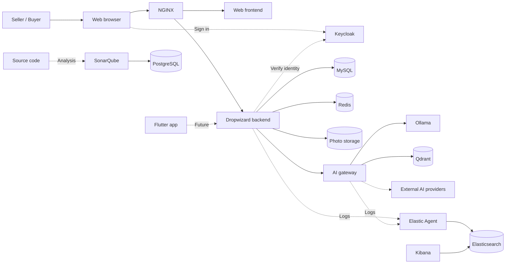

# LoopMarket

LoopMarket is a planned second-hand marketplace where sellers create listings with optional AI assistance and buyers can express interest. Sellers review and approve everything before publication.

**Status:** Development container configuration is in place. The marketplace, AI gateway, mobile app, and integrations are not implemented yet.

## Quick start

Requires Docker and Docker Compose 2.20 or later. From the repository root:

```sh
./.docker/server.sh list                 # List services
./.docker/server.sh status               # Show state and memory usage
./.docker/server.sh start mysql redis    # Start selected services
./.docker/server.sh stop mysql redis     # Stop selected services
./.docker/server.sh start all            # Start every service
./.docker/server.sh stop all             # Stop every service
```

Service names and the action can appear in any order. Starting builds images and may download them; stopping preserves containers and volumes. The application workspaces currently idle, so the marketplace is not yet available.

## Services

Each service has its own Dockerfile and Compose definition. All containers share the `zartis` network.

```text
LoopMarket
├── Backend
│   └── Backend application     (Java and Dropwizard)
├── Frontend
│   └── Web application         (Next.js, React and TypeScript, proposed)
├── Mobile
│   └── Mobile application      (Flutter and Dart, planned)
├── AI
│   ├── AI gateway              (model routing and provider integrations, planned)
│   └── Ollama                  (local model runtime)
└── Infrastructure
    ├── NGINX                   (application ingress)
    ├── MySQL                   (marketplace data)
    ├── Redis                   (user session cache)
    ├── Qdrant                  (AI vector database)
    ├── Keycloak                (identity provider)
    ├── SonarQube               (code quality)
    ├── PostgreSQL              (SonarQube database)
    ├── Elasticsearch           (observability data)
    ├── Kibana                  (observability interface)
    └── Elastic Agent           (log and metrics collection)
```

## Configuration

- `.env-dev` contains local ports and credentials; it is created from `.env-dev.example` and is ignored by Git.
- The root Compose file delegates to `.docker/docker-compose.yaml` and the individual service definitions.
- `make check` validates Compose and tests resource preparation with a simulated Docker daemon.
- Development credentials and disabled Elasticsearch authentication are for local use only.
- Image builds and service integrations have not yet been verified. Ollama does not include downloaded models.

## Planned architecture


