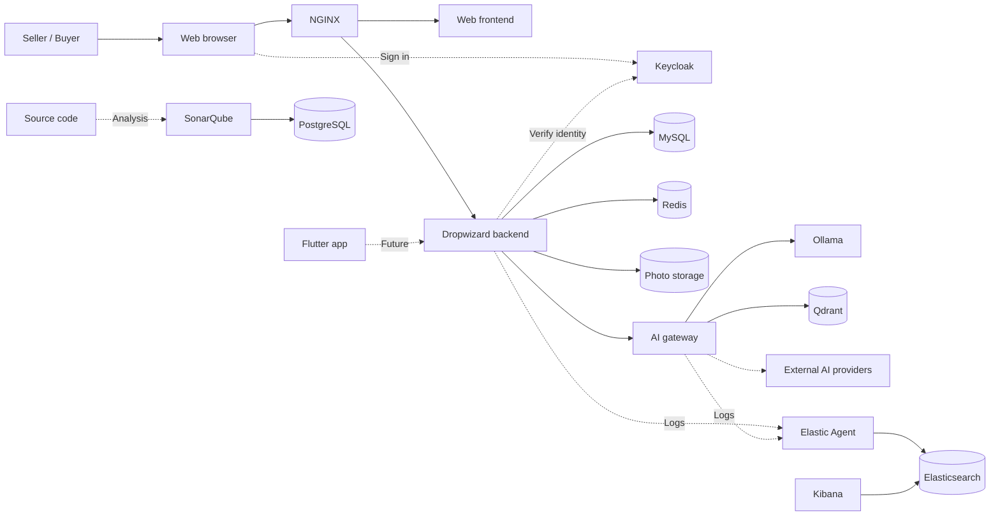
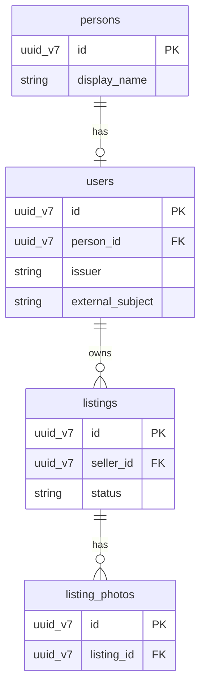
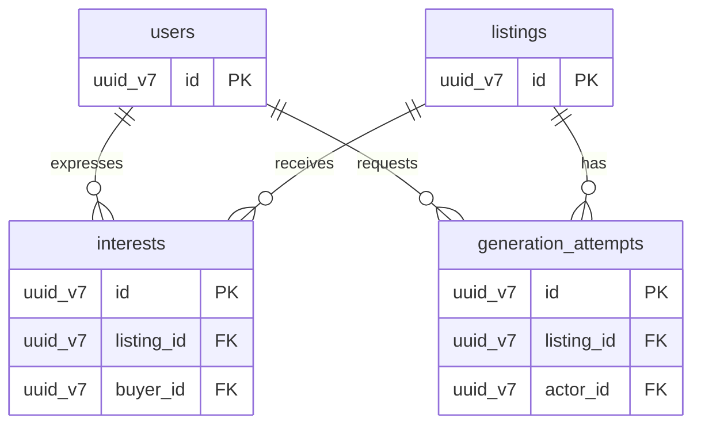

<h1 align="center">LoopMarket</h1>

<p align="center">
  <strong>A marketplace for second chances, built with an agentic mindset.</strong>
</p>

<p align="center">
  
  
  
  
</p>

LoopMarket is a planned second-hand marketplace where sellers create listings with optional AI assistance and buyers can express interest. Sellers review and approve everything before publication.

**Status:** The first Dropwizard hello endpoint and API documentation are implemented but awaiting runtime verification. The marketplace, AI gateway, mobile app, and integrations are not implemented yet.

## Quick start

Requires Docker and Docker Compose 2.20 or later. From the repository root:

```sh
./.docker/server.sh dev list                 # List services
./.docker/server.sh dev status               # Show state and memory usage
./.docker/server.sh dev logs backend redis   # Follow logs from selected services
./.docker/server.sh dev start mysql redis     # Start selected services
./.docker/server.sh dev stop mysql redis      # Stop selected services
./.docker/server.sh dev start all             # Start every service
./.docker/server.sh dev stop all              # Stop every service
```

The first argument selects the environment. `dev` is configured; `qat`, `uat`, and `prd` are reserved and fail without touching development resources until their own configurations are added. After the environment, service names and the action can appear in any order. Starting builds images and may download them; stopping preserves containers and volumes. The marketplace is not yet available.

Use `dev logs all` to follow every service. Log lines carry aligned service tags; press `Ctrl+C` to stop following them.

To start the initial backend and explore its API:

```sh
./.docker/server.sh dev start backend
```

With the default ports, the hello endpoint is `http://localhost:8080/api/hello` and Swagger UI is `http://localhost:8080/api/docs/`. Starting the backend also starts MySQL and waits for its health check. Database connection settings come from `.env-dev`; the backend uses MySQL's internal service name and application credentials. The backend builds with Maven inside its container on startup; a first build needs dependency downloads. The administrative connector is private to the container and includes a database health check. The MySQL connection and health check have not yet been verified in a running container.

## Services

Each service has its own Dockerfile and Compose definition. All containers share the `zartis` network.

```text
LoopMarket
├── Backend
│   └── Backend application     (Java and Dropwizard)
├── Frontend
│   └── Web application         (Next.js, React and TypeScript, proposed)
├── Mobile
│   └── Mobile application      (Flutter and Dart, planned)
├── AI
│   ├── AI gateway              (model routing and provider integrations, planned)
│   └── Ollama                  (local model runtime)
└── Infrastructure
    ├── NGINX                   (application ingress)
    ├── MySQL                   (marketplace data)
    ├── Redis                   (user session cache)
    ├── Qdrant                  (AI vector database)
    ├── Keycloak                (identity provider)
    ├── SonarQube               (code quality)
    ├── PostgreSQL              (SonarQube database)
    ├── Elasticsearch           (observability data)
    ├── Kibana                  (observability interface)
    └── Elastic Agent           (log and metrics collection)
```

## Configuration

- `.env-dev` contains local ports and credentials; it is created from `.env-dev.example` and is ignored by Git.
- The root Compose file delegates to `.docker/docker-compose.yaml` and the individual service definitions.
- `make check` validates Compose and tests resource preparation with a simulated Docker daemon.
- Development credentials and disabled Elasticsearch authentication are for local use only.
- Image builds and service integrations have not yet been verified. Ollama does not include downloaded models.

Code comments should be professional, short, and clear, with friendly, subtle Sith or Star Wars references.

## Planned architecture



## Data model

The MVP model uses UUIDv7 IDs and UTC creation, update, and soft-deletion timestamps on every table. The diagrams show relationship keys; see [the database model](docs/database-model.md) for all fields and rules. MySQL stores product data, while Redis holds temporary session state and is not a table in these diagrams.

### Accounts and listings



A listing may have at most one **active** photo; older soft-deleted records can remain.

### Buyer interest and AI


