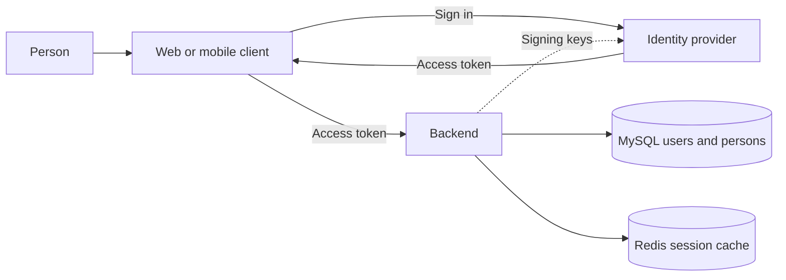

# Database model

This is the LoopMarket MVP data model. The initial MySQL schema and development identity seed are implemented with Liquibase in `backend/app/src/main/resources/db`.

## Common fields

Every table has these fields:

| Field | Meaning |
|---|---|
| `id` | UUIDv7 primary key, generated by the application. |
| `created_at` | Creation instant. |
| `updated_at` | Last update instant. |
| `deleted_at` | Deletion instant, nullable until the row is soft-deleted. |

All timestamps represent instants in UTC, returned by the API with an explicit UTC offset. MySQL does not preserve the original time zone in `DATETIME` or `TIMESTAMP`; the MVP does not store it separately. The migration uses `DATETIME(6)` and the backend configures Hibernate to use UTC.

UUIDs are stored as `BINARY(16)` in standard byte order. The version-1 byte-swapping option must not be applied to UUIDv7.

## Tables

### `persons`

A person's marketplace profile, independent of the authentication provider.

| Field | Meaning |
|---|---|
| `display_name` | Name shown on listings and to sellers who receive interest. |

Only the display name is required for the MVP; additional personal or contact data needs a product requirement.

### `users`

A local account mapped to a verified external identity and one person. A user may be both seller and buyer.

| Field | Meaning |
|---|---|
| `person_id` | Profile, referencing `persons.id`; unique and required. |
| `issuer` | Identity provider issuer. |
| `external_subject` | Subject returned by the provider; not assumed to be a UUID. |
| `account_role` | Application authorization role. |
| `auth_version` | Version used to invalidate sessions after account changes. |

The pair `(issuer, external_subject)` uniquely identifies the external identity. One person can have at most one user account in this MVP. Passwords and provider credentials are not stored here. Creating an account and its person must be transactional; soft-deletion and any later account reactivation need an explicit policy.

### `listings`

A seller's draft or published item.

| Field | Meaning |
|---|---|
| `seller_id` | Owner, referencing `users.id`. |
| `title`, `description` | Seller-reviewed listing content. |
| `category`, `condition` | Values from the supported product lists. |
| `city` | Item location as text. |
| `price`, `currency` | Decimal amount and currency; never floating point. |
| `status` | `DRAFT`, `PUBLISHED` or `ARCHIVED`. |
| `version` | Optimistic concurrency version. |

Draft fields may be incomplete. Publishing and editing a published listing require all mandatory fields and a valid photo. Only the owner can change a listing. Archived or soft-deleted listings do not appear in public search.

### `listing_photos`

Metadata for the single listing photo; the image itself lives in the configured storage service or volume.

| Field | Meaning |
|---|---|
| `listing_id` | Referenced listing. |
| `storage_key` | Server-controlled key for the stored image. |
| `media_type`, `byte_size` | Validated image metadata. |
| `validation_status` | Photo validation state. |

At most five active photos are allowed per listing; the photo service locks the listing while counting and creating photos. A replacement is validated and written under a new key before the database reference changes, including for published listings. Rejected images leave the previous reference intact. Old files and files written before a failed database transaction are retained; orphan cleanup is not implemented.

### `interests`

A buyer's interest in a published listing. This is not a message or an order.

| Field | Meaning |
|---|---|
| `listing_id` | Listing receiving the interest. |
| `buyer_id` | Interested user. |

A buyer cannot express interest in their own listing. The pair `(listing_id, buyer_id)` is unique in v1, making repeated requests safe. Existing interest stays available to the seller after an item is archived.

### `generation_attempts`

A record of a request for AI suggestions. Suggestions remain editable and cannot publish a listing.

| Field | Meaning |
|---|---|
| `listing_id`, `actor_id` | Draft and requesting user. |
| `request_key` | Idempotency key within the actor and operation scope. |
| `request_fingerprint` | Fingerprint used to detect a different payload under the same key. |
| `input_version`, `client_revision` | Persisted listing version and editor revision used for the request. |
| `mode`, `status` | Generation mode and request outcome. |
| `provider`, `model`, `prompt_version` | Provenance when applicable. |
| `suggestions` | Validated result, nullable until successful. |
| `usage_metadata` | Provider-reported usage when available. |

A request key must identify one request payload; reuse with different input is a conflict. Provider calls occur outside database transactions. Request identity and outcome must survive retries, including an explicitly unknown outcome after a crash.

## Identity and sessions

- The identity provider authenticates the person and issues tokens. The backend verifies the token before mapping `(issuer, subject)` to a local user.
- MySQL is the source of truth for local users, persons and marketplace records. Redis holds temporary user-session state with an expiration; it is not a relational table or the authoritative identity record.
- Development sessions use a 30-minute TTL and store only a hash of the opaque bearer token as their Redis key. Logout revokes the session.
- Each authenticated request checks Redis and confirms the MySQL account and profile are active and the account version still matches. Login creates a session only after the identity provider verifies the credentials.
- `users` owns the login identity; `persons` owns the marketplace profile. Both use UUIDv7 and UTC audit timestamps.

## Relationships and integrity

- Each user references exactly one person; each person has at most one user. A user owns many listings and can express interest in many listings.
- A listing has zero to five active photos, many interests and many generation attempts.
- Foreign keys preserve references; soft-deleted data is filtered according to the caller and operation.
- Price uses an exact decimal type. Precision, supported categories and field limits remain product decisions.
- Authorization, listing state transitions and preventing self-interest are enforced by the backend. Database foreign keys and unique constraints reinforce the rules where possible.
- Draft creation and publication idempotency may require additional operational metadata; its persistence design is not yet finalized.

### `listing_requests`

Stores the actor, operation, idempotency key, request fingerprint, listing reference and original response for draft creation and publication. The actor, operation and key are unique; records are retained without automatic expiration. Audit and UUIDv7 rules apply.
